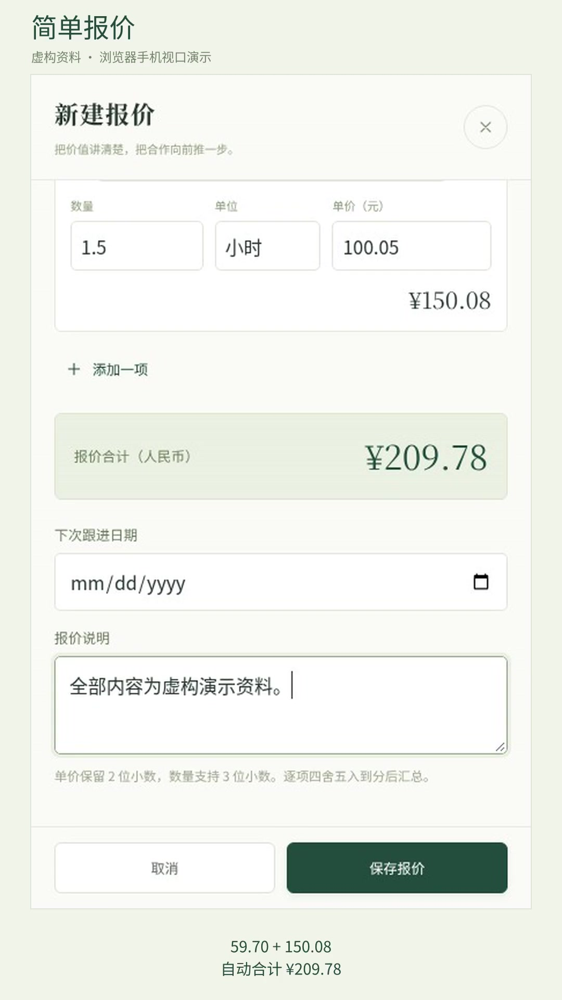

# 简单报价 1.1 · 单商家付费试用交付版

面向单个商家的手机网页工具：维护客户、创建报价、导出中文 PDF、记录成交进展。数据保存在本机服务端 SQLite，包含 5 个虚构客户和 5 份示例报价。没有 AI API、支付、多租户或外部客户数据连接。

本轮交付面向首批商家试用：新增首次商家配置、安全处理示例、复制报价、主动更新单张报价资料，以及自动日备份与下载列表。建议试售价和服务边界见 [试售方案](docs/TRIAL-OFFER.md)，安装、验收、售后与回访使用 [交付单](docs/HANDOVER.md)。价格与付费意愿尚未得到市场验证，没有真实成交或收入证明。

先看 [约两分钟的竖屏 Demo 视频](docs/evidence/merchant-quotes-demo.mp4)，包含真实浏览器操作、中文 PDF、跟进与实际重启验证；无声、带中文字幕，资料均为虚构。[视频制作与验收说明](docs/DEMO-VIDEO.md) · [可转发给商家的介绍文案](docs/SALES-MESSAGE.md)。

<a href="docs/evidence/merchant-quotes-demo.mp4"></a>

## 本地启动

需要 **Node.js 24 LTS** 和 npm。在本项目目录执行：

```bash
npm ci
npm start
```

电脑浏览器访问 **http://127.0.0.1:3000**。首次启动自动建库并装入虚构示例；后续启动保留数据，不重复装入示例。无需构建前端、API 密钥或下载字体，中文字体已随源码提供。

配置可从 `.env.example` 复制为 `.env`，`npm start` 会读取 `.env`。默认只监听本机。关闭终端服务后，再运行同一命令即可验证数据仍然存在。数据库及恢复前备份位于 `data/`，不要删除该目录。

## 手机局域网演示

在你自己的电脑、项目目录内执行：

```bash
npm ci
npm run demo:lan
```

首次运行会在没有现有配置时生成 `.env` 和随机访问密码；打开 `.env` 查看 `APP_PASSWORD`。终端会列出手机可访问的局域网地址，用户名固定为 `merchant`。保持窗口打开，手机连接同一 Wi-Fi 后访问显示的地址。完整操作与真机验收步骤见 [手机演示指南](docs/PHONE-DEMO.md)。

若希望用普通 `npm start` 手动配置局域网访问，在 `.env` 设置：

```dotenv
HOST=0.0.0.0
PORT=3000
APP_PASSWORD=这里替换为你自己设置的至少12位密码
```

重新启动。手机与电脑连接同一局域网，访问 `http://电脑的局域网IP:3000`。浏览器提示登录时，用户名是 **merchant**，密码是你设置的 `APP_PASSWORD`。需要在电脑防火墙允许局域网访问该端口。`127.0.0.1` 在手机上指手机自身，不能用来访问电脑服务。

云端任务容器的回环地址也不是你电脑的回环地址。本次没有发布公网 Demo；请下载源码到本机启动，或由你配置云端端口转发。真实数据试用应使用 HTTPS 和访问密码。

## 一次完整演示

1. 打开“客户”，新增虚构客户“演示验收商店”，填写联系人和电话。可以搜索并编辑该客户。
2. 点击该客户的“为他报价”，填写报价名称。
3. 添加“中文展示架”：数量 `3`，单价 `19.90`；再添加“中文安装服务”：数量 `1.5`，单价 `100.05`。自动得到 `59.70 + 150.08 = 209.78` 元。
4. 保存报价，在详情底部点击“导出中文 PDF”。浏览器下载的 PDF 含客户、商家、日期、项目明细、合计与条款。
5. 在详情内把状态改为“已成交”，填写下次跟进日期和记录，点击“保存跟进”。
6. 结束服务进程，再运行 `npm start`。刷新网页并搜索这份报价，客户信息、`¥209.78`、成交状态与跟进记录仍然存在。

本流程已通过真实浏览器自动化和服务进程重启验证，见 [1.1 验收报告](docs/ACCEPTANCE-1.1.md)。演示用中文 PDF 和手机截图在 [docs/evidence](docs/evidence)。

## 从演示开始自己的商家

点击页面上的“配置我的商家”，填写自己的商家资料和真实合作条款。新演示商家的向导使用中性条款，不默认承诺演示中的税费或预付款比例；旧版已使用商家的资料和自定义条款会保留供核对。

你可以保留全部记录，或仅移除带来源标记、且未被自己修改的示例。自己新增或编辑的记录会保留；被自己的报价引用的客户也会保留。旧版记录不按名称判定为示例。配置前会先保存完整副本，备份失败则不会清理资料。

如果明确选择完全空白开始，需要输入“清空全部客户和报价”确认；这一操作会清空所有现有客户和报价，请先核对范围。配置完成后，在商家设置继续编辑资料。配置前的副本可在备份列表下载，并通过恢复入口还原。

报价详情支持“复制报价”：生成新编号、当天日期、待回复状态和空跟进历史，沿用项目和说明并使用当前客户及商家资料，原报价不变。编辑旧报价时，默认保留原始资料；可以明确勾选“使用最新客户资料 / 使用最新商家资料”，仅更新当前报价与其后导出的 PDF。

## 备份与恢复

“商家设置 → 导出备份”下载 JSON，包含客户、报价、商家快照和跟进历史。将备份复制到另一设备保存。

“恢复备份”选择本工具导出的 JSON，核对数量后确认替换。服务端会校验版本、字段、日期、关联和金额；无效文件不会改动现有记录。有效文件通过事务整体恢复，并先保存 `data/backups/before-restore-*.json`。恢复前副本可以通过同一入口再次导入。文件上限 8 MB；不要导入不属于你的商家数据。导出文件为明文，请按商家资料保管。

1.1 导出 v2 备份，包含示例来源与首次配置状态；可以导入旧 v1 备份，导入时将记录视为已使用资料，保留全部记录。旧 1.0 应用不能读取 v2 备份；升级前请保留旧版源码和旧版本导出的备份，回滚步骤见交付单。

自动日备份在启动、打开工作台和运行期间每小时检查时补齐，北京时间每天最多一份，保留最近 14 份。当天已有文件不覆盖，因此当天的新资料仍应在营业结束时手动导出。程序关闭时不会备份。配置前、恢复前副本不随日备份轮换删除。备份列表可下载这些文件，再上传恢复；请保留异机副本，应对电脑或磁盘故障。

迁移到另一台电脑：停止原服务、保存 JSON 备份，在新电脑启动后恢复即可。不要只复制运行中的 `quotes.sqlite`；SQLite WAL 文件可能仍包含最新数据。

## Docker 部署

项目包含 `Dockerfile` 和 `compose.yaml`，默认将端口仅映射到宿主机回环地址，并使用持久化命名卷。

```bash
cp .env.example .env
# 编辑 .env，设置至少 12 位的 APP_PASSWORD
docker compose up -d --build
docker compose logs -f quotes
```

访问 `http://127.0.0.1:3000`，用户名 `merchant`，密码见你自己的 `.env`。重启使用 `docker compose restart`。停止使用 `docker compose down`；保留数据时不要使用 `down -v`。

真实商家首次部署可在新数据库创建前设置 `SEED_DEMO=false`，然后通过首次配置填写自己的信息。此选项不会清空已有演示数据库；已有数据可通过首次配置安全处理，或使用新的数据目录或命名卷。

人工生产部署步骤：准备支持持久卷的单台主机，设置密码，启动容器，将 HTTPS 反向代理接到宿主机 `127.0.0.1:3000`，按需配置域名、证书和定期异机备份。只运行一个应用副本。这个版本使用本地 SQLite，不适合放在会清空文件系统的无状态函数平台。

Docker 的镜像构建、非 root 容器启动、密码访问、中文 PDF、健康检查，以及重启和重建后接回命名卷的验收结果见 [1.1 Docker 验证记录](docs/evidence/docker-verification-1.1.json)。测试使用独立虚构数据，临时容器和数据卷在验证后清理。没有购买云服务、绑定支付或发布生产服务。

在带自定义代理 CA 的托管云环境构建时，可使用：

```bash
docker build --secret id=proxy_ca,src="$CODEX_PROXY_CERT" -t merchant-quotes .
```

普通本机 Docker 构建不需要该 secret。保持证书校验开启。

## 自动化验证

```bash
npm test
npm run test:e2e
npm run licenses
```

`npm test` 使用 Node 自带测试框架，覆盖金额精度、非法输入、客户编辑与报价快照、编辑冲突、数据库重新打开、恢复保护、HTTP API、中文 PDF 响应、密码保护，以及示例来源保护、旧版数据迁移、首次配置和自动日备份。

`test:e2e` 使用 Playwright，依赖 Chromium 和 Poppler 的 `pdftotext`，用于检验导出 PDF 中的中文与金额。Linux 会优先使用 `/usr/bin/chromium`；其他环境可先运行 `npx playwright install chromium`，或设置 `CHROMIUM_PATH`。Ubuntu/Debian 的 PDF 文本工具可用 `sudo apt-get install poppler-utils` 安装。端到端测试会新建并删除独立临时数据库，不改动商家的 `data/`，并更新虚构演示截图与 PDF。

## 技术与边界

- Node.js 24 / Express 5 / better-sqlite3 / pdfme 6，依赖精确版本及完整 lockfile 随仓库提供。
- 原生 HTML、CSS、JavaScript；主要表单、客户搜索、PDF 下载和备份恢复均可在手机完成。
- 币种固定人民币；数量最多 3 位小数，单价最多 2 位，每行四舍五入到分后求和。单张最多 100 行，总额最多 999,999,999.99 元。
- 客户、商家信息随报价保存快照；明确选择更新资料时只更新当前单据。复制报价会使用当前基础资料。
- 状态为待回复、已成交、未成交；跟进页按日期展示待回复报价，含过期和未安排项目。日期按北京时间处理，无后台提醒推送。
- PDF 是专业固定版式，支持自动分页；本版本不含模板设计器、账户角色、电子签章、在线收款或税务开票。
- 外部监听强制要求至少 12 位密码；本机无密码演示模式默认只绑定 `127.0.0.1`。商家登录使用 HTTP Basic，需要 HTTPS 才适合真实远程访问。

## 许可证

本项目源码采用 MIT。pdfme 的 MIT 版权全文、所有已安装依赖的许可证与声明清单见 [THIRD_PARTY_NOTICES.md](THIRD_PARTY_NOTICES.md)。中文字体 Noto Sans CJK SC 保留原字形与名称，以 OFL 1.1 分发，全文见 [fonts/OFL.txt](fonts/OFL.txt)。字体从系统官方 Noto CJK 字体集合中提取 SC 字面，运行与部署均不依赖系统字体。
